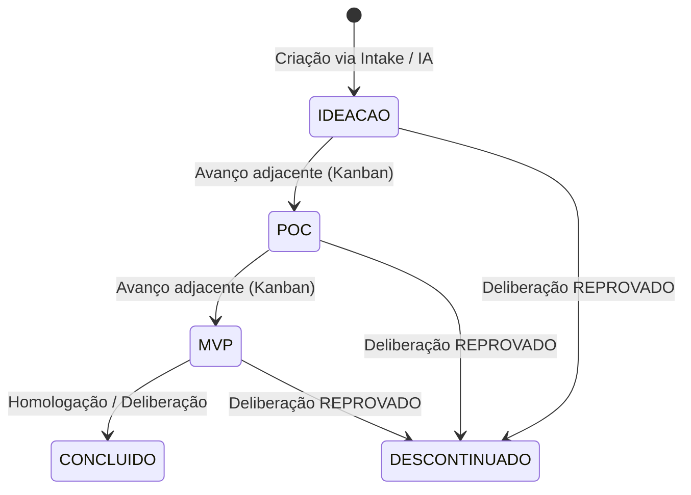

# 📘 SIGES-PIN — Documentação Técnica: Fase 1 (Front-end)

**Sistema Corporativo de Gestão do Portfólio de Inovação da BBTS**

> **Data:** 09/10/2026  
> **Versão:** 1.0 — Camada de Domínio, Setup, Tipos e Integração Base  
> **Equipe:** Front-end SIGES-PIN (Squad 36 — Residência Tecnológica / TakeOff)

---

## 📑 Índice

1. [Visão Geral do Projeto](#1-visão-geral-do-projeto)
2. [Stack Tecnológica](#2-stack-tecnológica)
3. [Estrutura de Pastas do Código](#3-estrutura-de-pastas-do-código)
4. [Conceitos Fundamentais de Front-end](#4-conceitos-fundamentais-de-front-end)
   - 4.1 [O que é um Componente e Props](#41-o-que-é-um-componente-e-props)
   - 4.2 [O que são Hooks (`useState`, `useEffect` e Custom Hooks)](#42-o-que-são-hooks-usestate-useeffect-e-custom-hooks)
   - 4.3 [O que é a Context API (Gerenciamento Global)](#43-o-que-é-a-context-api-gerenciamento-global)
   - 4.4 [Por que TypeScript? (Eliminando erros em tempo de compilação)](#44-por-que-typescript-eliminando-erros-em-tempo-de-compilação)
   - 4.5 [Como o Front-end conversa com o Spring Boot via Axios](#45-como-o-front-end-conversa-com-o-spring-boot-via-axios)
5. [Configuração Inicial da Aplicação](#5-configuração-inicial-da-aplicação)
6. [Modelagem de Dados e Camada de Domínio](#6-modelagem-de-dados-e-camada-de-domínio)
   - 6.1 [Fluxo de Estados do Funil de Inovação](#61-fluxo-de-estados-do-funil-de-inovação)
   - 6.2 [Enumeradores Oficiais](#62-enumeradores-oficiais)
   - 6.3 [Interfaces TypeScript (Detalhamento Campo a Campo)](#63-interfaces-typescript-detalhamento-campo-a-campo)
7. [Camada de Integração HTTP (Axios e Interceptors)](#7-camada-de-integração-http-axios-e-interceptors)
8. [Design System Base e Tokens Visuais](#8-design-system-base-e-tokens-visuais)
9. [Glossário de Hooks e Utilitários](#9-glossário-de-hooks-e-utilitários)
10. [Próximos Passos](#10-próximos-passos)

---

## 1. Visão Geral do Projeto

O **SIGES-PIN** é o sistema corporativo que digitaliza o portfólio de inovação da BBTS, estruturado segundo o procedimento operacional normativo **PRO663-009**. O front-end atua como o ponto de contato diário para demandantes de negócio, analistas do hub de inovação, comitês deliberativos e diretores executivos.

| Pilar | Papel do Front-end |
|---|---|
| **Intake com IA** | Formulário ágil que captura a dor operacional, aciona a IA com guardrails de validação, exibe respostas sugeridas (Human-in-the-Loop) e degrada graciosamente caso a IA esteja fora. |
| **Funil Stage-Gates** | Quadro Kanban interativo que controla a evolução visual dos projetos entre `IDEAÇÃO → POC → MVP → CONCLUÍDO`, com validação de transições adjacentes. |
| **Maturidade TRL & Radar 4D** | Régua segmentada de maturidade (TRL 1 a 9) com checklist técnico e gráfico Radar 4D comparando a visão inicial da IA com reavaliações do comitê. |
| **Governança & Auditoria** | Telas para deliberação formal (Aprovar, Pivotar, Reprovar), controle de acesso por perfil (RBAC), upload de evidências no AWS S3 e visualização de auditoria. |

---

## 2. Stack Tecnológica

| Componente | Tecnologia | Versão | Justificativa |
|---|---|---|---|
| **Linguagem** | TypeScript | 5.x+ | Tipagem estática rigorosa; previne inconsistências de dados com a API Java. |
| **Framework Base** | React.js | 18.3+ | Ecossistema reativo moderno, facilidade de componentização e performance. |
| **Build Tool** | Vite | 5.x+ | Servidor de desenvolvimento ultrarrápido com Hot Module Replacement (HMR). |
| **Estilização** | Tailwind CSS | 3.4+ | Utilitários de estilização diretamente nas classes, garantindo fidelidade ao Design System. |
| **Roteamento** | React Router DOM | 6.22+ | Gerenciamento de rotas, navegação programática e proteção de rotas privadas. |
| **Cliente HTTP** | Axios | 1.7+ | Requisições HTTP com interceptors automáticos para Bearer Token JWT e erros. |
| **Gráficos** | Chart.js / react-chartjs-2 | 4.4+ / 5.2+ | Renderização leve do Gráfico Radar 4D e gráficos de KPIs do dashboard. |
| **Drag and Drop** | @dnd-kit | 6.x+ | Biblioteca acessível e performática para movimentação de cards no Kanban. |
| **Ícones** | Lucide React | 0.400+ | Conjunto consistente de ícones SVG idêntico ao protótipo de alta fidelidade. |
| **Feedback (Toasts)** | Sonner | 1.5+ | Alertas contextuais empilháveis (sucesso, aviso, erro de regras de negócio). |

---

## 3. Estrutura de Pastas do Código

```
sigespin-frontend/src/
├── assets/                          ← Imagens, logos e SVGs institucionais
│   ├── logo-bbts.svg
│   └── sp-badge.svg
│
├── components/                      ← Blocos de interface reutilizáveis
│   ├── common/                      ← Elementos básicos (Button, Input, Badge, Modal, Card)
│   ├── layout/                      ← Sidebar, Header e Container mestre
│   ├── kanban/                      ← Componentes do quadro (Board, Column, Card)
│   ├── trl/                         ← Régua visual segmentada e checklist
│   ├── radar/                       ← Componente de gráfico Radar 4D (Chart.js)
│   └── governanca/                  ← Modal de deliberação e linha do tempo
│
├── contexts/                        ← Estado global compartilhado
│   └── AuthContext.tsx              ← Sessão JWT, dados do usuário e RBAC
│
├── hooks/                           ← Lógica desacoplada reutilizável
│   ├── useAuth.ts                   ← Acesso rápido ao contexto de autenticação
│   ├── useProjetos.ts               ← Busca, listagem e filtros de projetos
│   └── useDebounce.ts               ← Debounce para barra de pesquisa reativa
│
├── pages/                           ← Telas principais da aplicação
│   ├── LoginPage.tsx                ← Acesso ao sistema
│   ├── DashboardPage.tsx            ← Visão executiva e KPIs
│   ├── PortfolioKanbanPage.tsx      ← Funil em modo Kanban
│   ├── PortfolioListPage.tsx        ← Funil em modo Tabela/Lista
│   ├── ProjetoDetalhesPage.tsx      ← Visão completa do projeto e abas
│   └── IntakePage.tsx               ← Cadastro assistido por IA
│
├── services/                        ← Comunicação com a API RESTful do Spring Boot
│   ├── api.ts                       ← Configuração do Axios e interceptors
│   ├── authService.ts               ← Login e encerramento de sessão
│   ├── projetoService.ts            ← Endpoints /api/projetos
│   └── iaService.ts                 ← Endpoint /api/ia/analisar-demanda
│
├── types/                           ← Definições e contratos de tipos TypeScript
│   ├── projeto.ts                   ← Entidades, Enums e DTOs
│   └── api.ts                       ← Formato padrão de erro do servidor
│
├── utils/                           ← Funções auxiliares e formatações
│   ├── formatters.ts                ← Formatação de BRL, datas ISO e números
│   └── constants.ts                 ← Cores de Arenas, rótulos e status
│
├── App.tsx                          ← Configuração de rotas e providers
├── main.tsx                         ← Ponto de entrada do React
└── index.css                        ← Diretivas do Tailwind CSS
```

---

## 4. Conceitos Fundamentais de Front-end

Para nivelar a equipe e garantir código limpo, destacamos cinco conceitos essenciais adotados na arquitetura:

### 4.1 O que é um Componente e Props

Um **Componente** é uma função JavaScript/TypeScript que retorna JSX (interface visual). Cada componente encapsula sua própria estrutura e estilo.
**Props** são os parâmetros de entrada passados para o componente, permitindo que ele seja configurável e reutilizável em diferentes telas.

```tsx
// Exemplo: Componente de Badge reutilizável
interface BadgeProps {
  label: string;
  variante: 'sucesso' | 'alerta' | 'perigo' | 'neutro';
}

export const Badge: React.FC<BadgeProps> = ({ label, variante }) => {
  const cores = {
    sucesso: 'bg-emerald-50 text-emerald-700 border-emerald-200',
    alerta: 'bg-amber-50 text-amber-700 border-amber-200',
    perigo: 'bg-rose-50 text-rose-700 border-rose-200',
    neutro: 'bg-slate-100 text-slate-700 border-slate-200',
  };

  return (
    <span className={`px-2.5 py-0.5 rounded-full text-xs font-medium border ${cores[variante]}`}>
      {label}
    </span>
  );
};
```

### 4.2 O que são Hooks (`useState`, `useEffect` e Custom Hooks)

* `useState`: Armazena o estado interno do componente (ex: se um modal está aberto, texto digitado). Quando o estado muda, o React redesenha a tela automaticamente.
* `useEffect`: Executa efeitos colaterais (ex: buscar dados na API quando a tela é carregada).
* **Custom Hooks:** Funções que começam com `use` e empacotam lógica de estado complexa para que múltiplos componentes possam usá-la sem duplicar código (ex: `useProjetos()`).

### 4.3 O que é a Context API (Gerenciamento Global)

Permite compartilhar dados com toda a árvore de componentes sem precisar passar props manualmente de pai para filho em múltiplos níveis. No SIGES-PIN, usamos o `AuthContext` para disponibilizar o usuário autenticado, seu perfil e as funções de permissão (RBAC) em qualquer tela.

### 4.4 Por que TypeScript? (Eliminando erros em tempo de compilação)

O TypeScript funciona como uma camada de proteção pré-execução. Se o back-end espera que o status do projeto seja `IDEACAO` e tentarmos enviar `"ideacao"` minúsculo, o compilador TypeScript aponta o erro instantaneamente no editor de código, evitando bugs silenciosos em produção.

### 4.5 Como o Front-end conversa com o Spring Boot via Axios

O front-end não acessa o banco de dados diretamente. Ele realiza requisições HTTP RESTful para a URL base `/api`. Cada requisição é interceptada para incluir o cabeçalho `Authorization: Bearer <JWT>`, e cada resposta tem seu corpo convertido em objetos TypeScript tipados.

---

## 5. Configuração Inicial da Aplicação

### Arquivo: `vite.config.ts`

```typescript
import { defineConfig } from 'vite';
import react from '@vitejs/plugin-react';
import path from 'path';

export default defineConfig({
  plugins: [react()],
  resolve: {
    alias: {
      '@': path.resolve(__dirname, './src'),
    },
  },
  server: {
    port: 3000,
    proxy: {
      '/api': {
        target: 'http://localhost:8080',
        changeOrigin: true,
      },
    },
  },
});
```

### Arquivo: `tailwind.config.js`

```javascript
/** @type {import('tailwindcss').Config} */
export default {
  content: ['./index.html', './src/**/*.{js,ts,jsx,tsx}'],
  theme: {
    extend: {
      colors: {
        brand: {
          dark: '#18181B',
          primary: '#0F172A',
          subtle: '#64748B',
          background: '#F8FAFC',
        },
      },
    },
  },
  plugins: [],
};
```

---

## 6. Modelagem de Dados e Camada de Domínio

### 6.1 Fluxo de Estados do Funil de Inovação



### 6.2 Enumeradores Oficiais (`src/types/projeto.ts`)

Os enumeradores definem os valores restritos aceitos pelo sistema, idênticos aos do back-end Java:

| Enum | Valores | Significado no Front-end |
|---|---|---|
| `PerfilUsuario` | `DEMANDANTE`, `ANALISTA`, `COMITE`, `EXECUTIVO` | Controla visibilidade de botões e dados sensíveis (RBAC). |
| `ArenaTipo` | `EFICIENCIA_OPERACIONAL`, `NEGOCIOS_DIGITAIS`, `SEGURANCA_INTEGRADA`, `A_DEFINIR` | Arenas estratégicas da BBTS. `A_DEFINIR` é usado como fallback da IA. |
| `StatusFunil` | `IDEACAO`, `POC`, `MVP`, `CONCLUIDO`, `DESCONTINUADO` | Estágios do projeto no funil de inovação e colunas do Kanban. |
| `DecisaoTipo` | `APROVADO`, `PIVOTADO`, `REPROVADO` | Tipos de deliberação formal registrados pelo Comitê. |
| `TipoLeituraRadar` | `INICIAL`, `ATUAL` | Classifica se a nota do Radar 4D veio do Intake (IA) ou de reavaliação. |

### 6.3 Interfaces TypeScript (Detalhamento Campo a Campo)

#### 📄 `Usuario`
```typescript
export interface Usuario {
  id: number;
  nome: string;
  email: string;
  perfil: PerfilUsuario;
  ativo: boolean;
}
```

#### 📄 `Projeto` (Entidade Central)
```typescript
export interface Projeto {
  id: number;
  titulo: string;
  descricaoDor: string;
  areaDemandanteId: number;
  responsavelPoId: number;
  responsavelPo?: Usuario;
  arena: ArenaTipo;
  statusFunil: StatusFunil;
  trlAtual: number; // Inteiro de 1 a 9 (nunca regride)
  hipoteseSolucao: string;
  potencialLeiDoBem: boolean;
  dispendioEstimado: number | null; // NULL para DEMANDANTE e ANALISTA
  criadoEm: string;
  atualizadoEm: string;
  deliberacoes?: DeliberacaoHistorico[];
  avaliacoesRadar?: AvaliacaoRadar[];
  historicoTransicoes?: HistoricoTransicao[];
  evidencias?: Evidencia[];
}
```

#### 📄 `AvaliacaoRadar` e `ScoresRadar` (Maturidade 4D)
```typescript
export interface ScoresRadar {
  negocio: number; // 0.00 a 4.00
  produto: number; // 0.00 a 4.00
  time: number;    // 0.00 a 4.00
  receita: number; // 0.00 a 4.00
}

export interface AvaliacaoRadar {
  id: number;
  projetoId: number;
  tipoLeitura: TipoLeituraRadar;
  scoreNegocio: number;
  scoreProduto: number;
  scoreTime: number;
  scoreReceita: number;
  dataAvaliacao: string;
}
```

#### 📄 `DeliberacaoHistorico`
```typescript
export interface DeliberacaoHistorico {
  id: number;
  projetoId: number;
  responsavelId: number;
  responsavelNome?: string;
  decisao: DecisaoTipo;
  justificativa: string;
  dataDecisao: string;
}
```

#### 📄 `HistoricoTransicao` (Auditoria)
```typescript
export interface HistoricoTransicao {
  id: number;
  projetoId: number;
  usuarioId: number;
  usuarioNome?: string;
  tipoMudanca: 'STATUS_FUNIL' | 'TRL';
  valorAnterior: string;
  valorNovo: string;
  dataMudanca: string;
}
```

#### 📄 `Evidencia` (Anexos AWS S3)
```typescript
export interface Evidencia {
  id: number;
  projetoId: number;
  nomeArquivo: string;
  caminhoStorage: string; // URL pública ou pré-assinada do S3
  tipoArquivo: string;    // MIME type (ex: "application/pdf")
  dataUpload: string;
}
```

---

## 7. Camada de Integração HTTP (Axios e Interceptors)

O arquivo `src/services/api.ts` centraliza toda a lógica de transporte de dados:

```typescript
import axios, { AxiosError } from 'axios';
import { ApiErrorResponse } from '../types/api';

export const api = axios.create({
  baseURL: import.meta.env.VITE_API_BASE_URL || '/api',
  timeout: 10000,
});

// Interceptor 1: Injeta automaticamente o JWT salvo
api.interceptors.request.use((config) => {
  const token = localStorage.getItem('@SIGES_PIN:token');
  if (token && config.headers) {
    config.headers.Authorization = `Bearer ${token}`;
  }
  return config;
});

// Interceptor 2: Tratamento de expiração de sessão (401)
api.interceptors.response.use(
  (response) => response,
  (error: AxiosError<ApiErrorResponse>) => {
    if (error.response?.status === 401) {
      localStorage.removeItem('@SIGES_PIN:token');
      localStorage.removeItem('@SIGES_PIN:usuario');
      if (window.location.pathname !== '/login') {
        window.location.href = '/login?expirado=true';
      }
    }
    return Promise.reject(error);
  }
);
```

### Mapeamento dos Códigos de Erro do Back-end:
* `VALIDACAO_FALHOU` (HTTP 422): Erros de campos específicos; deve destacar visualmente o input no formulário.
* `TRL_NAO_PODE_REGREDIR` (HTTP 422): Tentativa de recuar nível TRL; deve exibir alerta e reverter o valor visual.
* `TRANSICAO_INVALIDA` (HTTP 422): Movimentação não permitida no funil; cancela o drag-and-drop.
* `IA_INDISPONIVEL` (HTTP 503): Falha na chamada ao Google Gemini; aciona o Graceful Fallback para preenchimento manual.
* `CREDENCIAIS_INVALIDAS` (HTTP 401): Mensagem de login incorreto.

---

## 8. Design System Base e Tokens Visuais

Baseado no protótipo homologado de 44 telas:

### Paleta Principal
* **Fundo da Aplicação:** `#F8FAFC` (`bg-slate-50`)
* **Superfície de Cards:** `#FFFFFF` (`bg-white`) com borda `#E2E8F0` (`border-slate-200`)
* **Botão Primário Corporativo:** `#18181B` (`bg-zinc-900 text-white hover:bg-zinc-800`)
* **Badge Logo "S-P":** Preto total (`bg-black text-white font-bold rounded`)

### Badges de Arenas Estratégicas (Normativo PRO663-009)
* **Eficiência Operacional:** `bg-blue-100 text-blue-800 border-blue-200`
* **Negócios Digitais:** `bg-purple-100 text-purple-800 border-purple-200`
* **Segurança Integrada:** `bg-teal-100 text-teal-800 border-teal-200`
* **A Definir:** `bg-slate-100 text-slate-600 border-dashed border-slate-300`

### Badges de Situação de Prazos
* **Em andamento:** `bg-emerald-50 text-emerald-700 border-emerald-200`
* **Pendente:** `bg-amber-50 text-amber-700 border-amber-200`
* **Atrasado / Vencido:** `bg-rose-50 text-rose-700 border-rose-200`

---

## 9. Glossário de Hooks e Utilitários

| Hook / Função | Onde fica | Função no Sistema |
|---|---|---|
| `useAuth()` | `src/hooks/useAuth.ts` | Retorna o usuário logado, estado de autenticação e função `temPerfil()`. |
| `podeVerFinanceiro()` | `AuthContext.tsx` | Retorna `true` apenas se o perfil for `COMITE` ou `EXECUTIVO`. |
| `formatarMoedaBRL(valor)` | `src/utils/formatters.ts` | Formata número em moeda brasileira (ex: `R$ 450.000,00`). |
| `formatarDataUTC(iso)` | `src/utils/formatters.ts` | Converte data ISO 8601 para formato local legível (`DD/MM/AAAA`). |
| `useDebounce(valor, delay)` | `src/hooks/useDebounce.ts` | Atrasa busca na API para evitar requisições a cada letra digitada. |

---

## 10. Próximos Passos

Com a Camada de Domínio, Modelos, Configuração e Design System estabelecidos na **Fase 1**, as próximas etapas de desenvolvimento do Front-end são:

| Fase | Escopo | Status |
|---|---|---|
| ✅ **Fase 1** | Modelagem de Domínio, Tipos TypeScript, Setup Vite e Design Tokens | **Concluída** |
| ⬜ **Fase 2** | Autenticação JWT, Proteção de Rotas e Shell de Layout (Sidebar/Header) | Próxima |
| ⬜ **Fase 3** | Módulo de Intake Inteligente (AI-First, Guardrails e Graceful Fallback) | Pendente |
| ⬜ **Fase 4** | Quadro Funil Kanban (`@dnd-kit`) e Alternância para Visão em Lista | Pendente |
| ⬜ **Fase 5** | Régua Interativa de Maturidade TRL (1 a 9) e Gráfico Radar 4D (Chart.js) | Pendente |
| ⬜ **Fase 6** | Governança: Painel de Deliberação (Stage-Gates) e Upload de Evidências S3 | Pendente |
| ⬜ **Fase 7** | Dashboard Executivo Consolidado e Refinamento de Acessibilidade (WCAG) | Pendente |

---

> **Documento gerado em:** 09/10/2026  
> **Referência Técnica:** Squad 36 — Residência Tecnológica BBTS / TakeOff  
> **Documentos Relacionados:**  
> - [SIGES-PIN: Master Spec Front-end](./SIGES-PIN_Master%20Spec%20Front-end.md)  
> - [SIGES-PIN: Master Spec Back-end](./SIGES-PIN_%20Master%20Spec%20Back-end.md)  
> - [DOCUMENTACAO_FASE1_DOMINIO (Back-end)](./DOCUMENTACAO_FASE1_DOMINIO.md)

